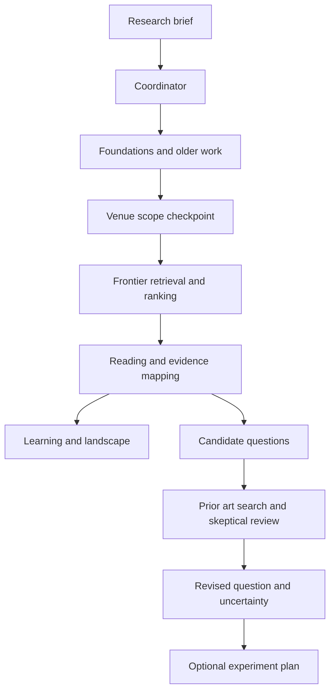

# Research Trail

**Explore a field. Connect its literature. Investigate a research gap.**

Research Trail is a visual research workspace with guided paths for beginners and intermediate researchers, and a complete exploration environment for advanced users. It brings field maps, paper connections, reading trails, evidence views and coordinated AI agents into one project.

The current prototype demonstrates **quantum mechanics**, from foundational concepts to a focused question about quantum error mitigation, calibration drift and sampling budgets.

**Status:** working prototype with a no-setup demo and a configurable Live backend. Prepared examples illustrate the workflow; they do not establish a novel research gap.

[Quick start](#quick-start) · [Three paths](#three-paths-one-project) · [Visualizations](#visualizations) · [Live setup](#run-with-live-agents) · [Architecture](ARCHITECTURE.md)

## Quick start

Download the repository and open [`static/index.html`](static/index.html) in a modern browser. Choose a road on the landing page, or select **Start quantum mechanics demo**.

The prepared demo requires no server, model, account or API key. It includes the complete three-path experience, paper connection graph, all eight lenses, agent playback and exports. Use **Guide** for the walkthrough and four-minute recording script, or **Reset demo** to start again.

GitHub displays HTML as source. Download the file to run it locally. Reading, lecture and repository links lead to external sites.

## Three paths, one project

The landing page keeps three starting questions and a road of interactive billboards for each path.

| Path | Starting question | Journey | Outcome |
| --- | --- | --- | --- |
| **Beginner** | “I’m finding my direction” | Choose a field and topic → visual learning resources → field map → broad open questions | A map of the field and a foundation for further reading |
| **Intermediate** | “I already have a topic” | Choose a subtopic or answer three scope questions → compare directions → optionally add papers and instructions → inspect the landscape | A focused direction supported by an understanding of the literature |
| **Advanced** | “I have papers to build on” | Prepare papers → describe an exact question beside their map → open the complete workspace | A scoped gap investigation with related work, challenges and possible first experiments |

The Intermediate **Explore** branch retains exactly three questions about interests, setting and research approach. Users who already have a subtopic can enter it directly.

Beginner **Discover** introduces ideas through large visual topic cards. **Map** is a separate step connecting concepts to literature. Advanced accepts up to **15 PDFs** and opens the map after paper preparation, beside the exact-question form.

The persistent level switch carries the project, notes, papers and selected question between paths. First entry to a level opens its billboards. **My billboards** returns to the route draft; the logo returns to the landing page.

## Visualizations

### Field map and paper connection graph

The field map organizes concepts, prerequisites and related readings. The **paper connection graph** connects studies through methods, findings, lineage, evaluation conditions and implementations.

Group papers by topic or venue to see colored regions and relationships across publications. Select a paper or connection to inspect its source and explanation. Relationship filters, zoom, pan and pinning help explore a focused part of the graph. Inferred connections remain visibly distinct from passage-supported connections.

### Eight gap lenses

| Lens | Question it helps investigate |
| --- | --- |
| Evidence coverage | Which branches have evidence in this corpus? |
| Method combinations | Which approaches appear together? |
| Claim comparison | Do the available passages support comparable findings? |
| Evaluation coverage | Which settings, conditions and outcomes were measured? |
| Tradeoff frontier | How do outcomes change with resource constraints? |
| Research to implementation | Where have methods been evaluated or implemented? |
| Limitation timeline | Which limitations recur across the literature? |
| Boundary map | Which method and context combinations lack evidence here? |

An empty cell describes this corpus. It does not prove that a topic is unexplored. Numerical comparisons require compatible tasks, datasets, platforms, protocols, baselines and units.

### Complete Advanced workspace

Advanced exposes all **12 tools**, including a mobile tool picker:

| Understand the field | Investigate the evidence | Develop the project |
| --- | --- | --- |
| Field map | Literature | Candidate gaps |
| Starting papers | Paper connection graph | First experiments |
| Learning trail | Eight gap lenses | Agent activity |
| Research scope | Review notebook | Master controls |

Billboards, maps, charts and workspace panels support fullscreen. Notes and route drafts persist locally. Exports include a Markdown field guide, JSON project evidence and an SVG paper map.

## How the agents work

A master coordinator organizes specialist tasks around the user's research brief. Several roles can share one model, or use separate models through Master controls.

| Role | Responsibility |
| --- | --- |
| Coordinator | Interpret the brief, scope the work and coordinate tasks |
| Source scout | Retrieve foundations, frontier work and related prior art |
| Ranking specialist | Prioritize reading using explicit scoring factors; no LLM required |
| Reader and learning guide | Extract available evidence and build research background |
| Connection mapper | Organize concepts and explain paper relationships |
| Gap investigator | Propose broad questions, landscape judgments or bounded candidate gaps |
| Skeptical reviewer | Search for existing answers, counterevidence and reasons to revise |
| Experiment designer | Suggest an optional baseline, comparison, measurements and stopping rule |

Up to **three custom specialists** can join the workflow with their own purpose and model routing.



Discovery, scope questions, resource requests and investigation actions trigger work. Opening another view reuses existing results. Full reviews begin with foundations, pause for venue scope when confirmation is needed, then investigate the frontier. Interview answers, notes and instructions carry into specialist context. Agent activity shows progress and failures; cancellation stops between tasks.

**Valency Bond is a discovery tool used by the Source Scout.** It retrieves available bibliographic information and abstracts. Crossref enriches missing metadata and provides fallback retrieval. Bond does not supply the coordinator or language model.

## Demo and Live modes

| Capability | Prepared Demo | Live |
| --- | --- | --- |
| Models | No model required; scripted agent playback | Your configured inference endpoints |
| Literature | 12 curated real teaching, paper and software records | Retrieved records and indexed user PDFs |
| Paper text | Four short, attributed primary abstract excerpts | Available abstracts and extracted uploaded text |
| PDF selection | Filenames only; contents stay unread | Files sent to the research service for indexing |
| Metric lenses | Eight synthetic studies in a separate, labeled benchmark context | Extracted observations with supporting passages |
| Gap assessment | Prepared examples showing the process | Candidate assessments within the searched scope |

The demo does not read complete papers or perform a current saturation survey. Its thematic graph links are curated inferences. Synthetic measurements are excluded from real-evidence exports.

Connecting Live clears prepared sources and results before real data loads. A failed Live task remains visible and never silently becomes a Demo result. **Use demo** restores the prepared project. Generated standalone demo files deliberately start in Demo.

## Run with Live agents

### Requirements

- **Python 3.11+** for the backend.
- An available **Ollama** server or **chat-compatible inference API**.
- **Node.js** only for the JavaScript verification suites.
- Optional PostgreSQL and Docker for shared worker deployments.

The frontend uses HTML, CSS, JavaScript, Canvas and SVG. The normal build does not require npm or a frontend bundler.

### Start the research service

Run these commands from the repository root.

**Windows**

```powershell
.\start.bat
```

**Linux or macOS**

```bash
bash start.sh
```

The launchers create a virtual environment, install the backend requirements and start the local service. Open the printed address, normally `http://127.0.0.1:8765`.

For a manual installation on Linux or macOS:

```bash
python3 -m venv .venv
.venv/bin/python -m pip install -r requirements.txt
.venv/bin/python -m backend.server
```

On Windows, use `py -3 -m venv .venv`, then `.venv\Scripts\python.exe` for the two Python commands.

### Connect a model

1. Open **Setup & models**.
2. Choose **Local Ollama**, **Rented API** or **Public or shared endpoint**.
3. Enter the research-service URL and token, then the inference URL and served model name.
4. Select **Test connection**, then **Connect Live**.
5. Start discovery or prepare your own papers.

The Ollama starter preset is `qwen3.5:9b`; install and serve the model separately. A public/shared option requires a working endpoint supplied by its operator. No free hosted inference service or model weights are bundled. Quantized models can participate when served through a supported adapter.

### Configuration

Set these environment variables in the process running the backend. The local launchers do not automatically load a `.env` file; Docker Compose uses its normal `.env` handling.

| Variable | Purpose |
| --- | --- |
| `MODEL_PROVIDER` | Default model adapter: `ollama` or `chat` |
| `MODEL_BASE_URL` | Inference service address reachable from the backend |
| `MODEL_NAME` | Served model name used to prefill setup |
| `MODEL_API_KEY` | Optional inference-provider credential |
| `MODEL_API_KEY_<ROLE>` | Optional per-role override, such as `MODEL_API_KEY_READER` |
| `TRAIL_API_TOKEN` | Research-service access token; required for a non-loopback server |
| `TRAIL_ALLOWED_ORIGINS` | Additional frontend origins when hosting separately |
| `DATABASE_URL` | PostgreSQL connection string or SQLite file path |
| `BOND_TOKEN` | Enable connected Bond discovery |
| `CROSSREF_MAILTO` | Contact address for Crossref requests |
| `GITHUB_TOKEN` | Optional credential for repository discovery |
| `TRAIL_SEARCH_URL` | Optional SearXNG service for resource discovery |
| `YOUTUBE_API_KEY` | Optional video discovery credential |

Provider credentials stay on the backend. Browser persistence excludes the workspace access token and indexed PDF contents. Documents sent for Live indexing may be included in requests to the configured inference provider.

### Shared deployment

The pilot uses SQLite and a durable job queue. The supplied Compose setup adds PostgreSQL, an API service and independently scalable workers. Inference remains a separate service. Use a model endpoint reachable from the containers; container loopback does not address the host's Ollama server.

See [Deployment](DEPLOYMENT.md) for configuration, workers, optional search and recovery. Organization identity and per-user authorization require additional integration before a shared production deployment.

## Sources and evidence

Learning begins with foundational concepts, open teaching resources and older work. The quantum mechanics profile uses a **journal-led frontier**; the computing profile retains conference-first ordering.

- A*/A/B conference eligibility requires a supplied, dated ranking registry.
- Q1/Q2 journal eligibility uses the included SJR index when a journal is matched, with ranking provenance.
- Preprints remain separately labeled during prior-art searches.
- Repository discovery distinguishes license, stars and actual subscriber counts.
- Reading priority is a triage score, not a judgment of scientific quality.

The interface distinguishes **metadata only**, **abstract indexed**, **PDF text indexed**, **passage matched**, **inferred** and **illustrative** evidence states. Quotations must match eligible indexed text and their stated location. Numerical observations require a matching passage containing the value from the same source. Background/profile documents do not support scientific claims.

A run uses its own discoveries, explicitly selected existing records and project PDFs. It does not inherit unrelated earlier searches merely because they share a workspace.

Live retrieval currently indexes available metadata and abstracts, while uploaded PDFs are processed separately. Automatic full-text retrieval, end-to-end open-access license enforcement and wiki crawling are not implemented. A passage match establishes provenance, not entailment, completeness or novelty. Sparse evidence and unsupported landscape judgments remain uncertain.

## Development and verification

Build the self-contained HTML from the repository root:

```bash
python build.py
```

This updates `static/index.html` and writes two standalone HTML demos into the parent directory. The app embeds its code and in-app guide without an asset CDN.

Run the backend and interaction checks:

```bash
python -m unittest discover -s tests -p "test_*.py"
node tests/frontend.cjs
node tests/trail.cjs
node tests/visuals.cjs
node tests/demo.cjs
node tests/experience.cjs
```

The recorded validation on **22 October 2026** passed **48 Python tests and five Node suites**. Coverage includes all three journeys, the three-question interview, all 12 tools, eight lenses, project continuity, fullscreen interactions, exports, cancellation, source isolation, quote checks and local HTTP/PDF processing. See [`qa/verification.json`](qa/verification.json).

The Node interaction suites use a deterministic DOM harness and do not measure browser layout. An optional Playwright check is available through `node tests/browser.cjs` when Playwright and Chromium are installed. Full browser layout, external inference/retrieval, PostgreSQL and Docker were not verified in the recorded run.

## Project layout

| Location | Purpose |
| --- | --- |
| `static/app.template.html` | Shared application shell |
| `static/trail-markup.html`, `trail-flow.js`, `trail-base.css` | Three-road landing and billboard journeys |
| `static/trail-adapter.js`, `trail-merge.css` | Handoff to the workspace and integrated styling |
| `static/workspace.js`, `workspace.css` | Project state, navigation, controls, exports and fullscreen |
| `static/canvas.js`, `visuals.js` | Visual rendering and evidence projections |
| `static/quantum-data.js`, `demo-provider.js` | Curated QM content and isolated synthetic benchmark |
| `backend/` | API, workers, model adapters, discovery, ranking and evidence validation |
| `config/` | Source policy examples, venue registry example and journal index |
| `docs/` | Shared guide content and editable-guide generator |
| `tests/` | Backend tests and JavaScript interaction suites |
| `build.py` | Standalone HTML builder |

## Documentation and contributions

- [Design](DESIGN.md): journeys, research workflow and product scope.
- [Architecture](ARCHITECTURE.md): modules, agent boundaries and evidence contracts.
- [Deployment](DEPLOYMENT.md): local and shared service setup.
- [Third-party notices](THIRD_PARTY_NOTICES.md): attribution and source boundaries.

Contributions can improve discovery adapters, source access, evidence validation, accessible visualizations, model support and deployment. Describe the user-visible behavior and relevant checks in a pull request. Keep Demo and Live data distinct, preserve all three entry paths, and label uncertainty wherever the evidence is incomplete.

## License

Application code is available under the [MIT License](LICENSE). Models, papers, ranking datasets and third-party components retain their own terms; see [Third-party notices](THIRD_PARTY_NOTICES.md).

**The supplied SJR index is not covered by the application's MIT license. Its redistribution terms still need review before publishing that dataset in a public repository.**
